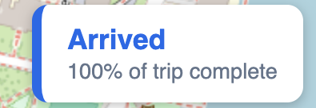
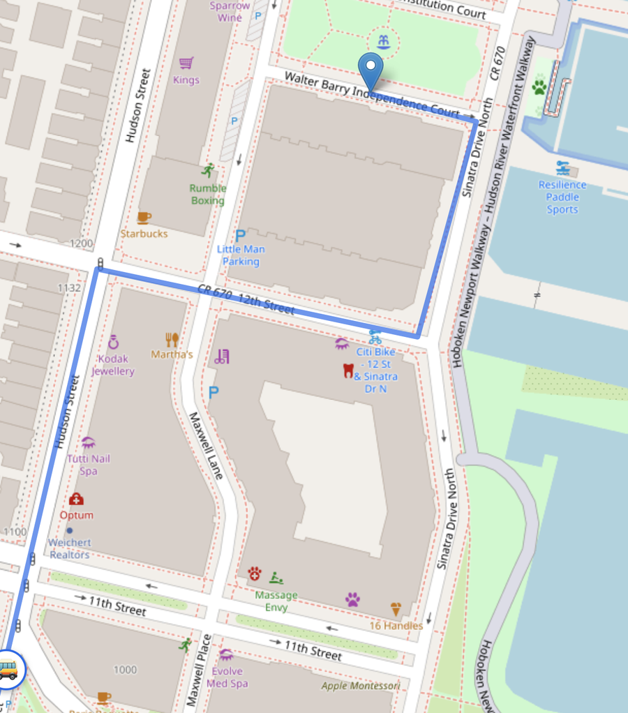

# Shipyard Shuttle Tracker

A web app that shows where a residential shuttle is and tells riders when it is running late. This is a working prototype driven by a simulated GPS feed, built so a real GPS tracker can replace the simulation later.

**Status:** prototype. Bus movement is simulated, and the route is provisional until it is confirmed with the shuttle operator.

## The problem

Residents of a Hoboken, NJ waterfront community ride a shuttle between the property and the Hoboken PATH station. In short interviews with two residents, the same frustration came up: not knowing when the shuttle is running behind, and hearing about schedule changes only by email. Both said they would use a live tracking app.

## What it does

- Shows a live map with a bus marker that moves along the street route
- Shows a color-coded status panel: **On Time**, **Running Late**, or **Arrived**
- Detects delays by comparing where the bus should be (from the schedule) with where it actually is
- Includes a configurable simulated stall so the delay logic can be tested end to end

## Screenshots

The status panel changes color as the trip progresses: on time, running late, and arrived.

<p align="center">
  
  
  
</p>

The route follows the streets, and the bus marker moves along it.

<p align="center">
  
</p>

## How it works

```
simulated GPS (Python)  -->  Flask JSON API  -->  Leaflet map in the browser
position_on_route()          /api/bus-location    polls every 2 seconds
```

### Moving the bus along a bent route

The route is a list of (latitude, longitude) corners in driving order. At startup the backend measures the length of each segment and the total route length. To place the bus at a given fraction of the trip, it converts that fraction to a distance, walks down the segments subtracting each length until the remainder fits inside one segment, then interpolates linearly inside that segment:

```
position = start + (end - start) * fraction
```

Distances use a flat-earth approximation: about 111,000 m per degree of latitude, with longitude scaled by the cosine of the latitude. Over a route of roughly 2 km the error is negligible.

### Delay detection

```
expected progress = elapsed time / scheduled trip duration
minutes late      = (expected progress - actual progress) * trip duration / 60
```

The status becomes `delayed` once the bus is 4 or more minutes behind schedule. The threshold is a constant, so it is easy to tune.

### Simulated stall

The simulation separates wall-clock time from moving time. During a stall, moving time stops advancing while the clock keeps running, so the bus freezes in place and then resumes where it stopped, already behind schedule. This lets the delay logic be exercised without waiting for real traffic.

### Single source of truth for the route

The route is defined once in `app.py` and served at `/api/route`. The frontend draws whatever the backend returns, so updating the route means editing one list.

## API

| Endpoint | Description |
|---|---|
| `GET /` | Health check |
| `GET /api/bus-location` | Current bus position, trip progress, and status |
| `GET /api/route` | Route as a list of `[lat, lng]` corners |
| `GET /map` | The map page |

Example response from `/api/bus-location` (values are illustrative):

```json
{
  "lat": 40.7509,
  "lng": -74.0257,
  "percent": 0.4,
  "status": "delayed"
}
```

## Run it locally

Requires Python 3.9 or newer.

```bash
git clone https://github.com/DiegoQuito21/Shipyard-Shuttle-Tracker.git
cd Shipyard-Shuttle-Tracker
python3 -m venv venv
source venv/bin/activate
pip install -r requirements.txt
python3 app.py
```

Then open http://127.0.0.1:5001/map.

The trip clock starts when the server starts, and a full demo run takes about 15 minutes (10 minutes of driving plus a 5 minute stall). The server uses port 5001 because macOS AirPlay Receiver occupies port 5000.

### Configuration

These constants sit near the top of `app.py`:

| Constant | Meaning |
|---|---|
| `trip_duration` | Scheduled trip length, in seconds |
| `STALL_START` | When the simulated stall begins, in seconds |
| `STALL_LENGTH` | How long the stall lasts, in seconds |
| `LATE_THRESHOLD_MIN` | Minutes behind schedule before the status becomes `delayed` |

## Project structure

```
Shipyard-Shuttle-Tracker/
├── app.py                 Flask app, route geometry, delay logic
├── static/
│   └── map.html           Leaflet map and status panel
├── docs/
│   └── screenshots/       Images used in this README
├── requirements.txt
└── README.md
```

## Design decisions

- **Simulation first.** Building against a simulated feed proves the product before any hardware is bought. Swapping in a real tracker only touches `get_bus_position()`.
- **Polling over WebSockets.** A bus moving at about 12 km/h does not need push updates. Polling every 2 seconds is simple and good enough.
- **Backend owns the logic.** The browser only displays what the API returns, so the delay rules live in one place.

## Known limitations and roadmap

- [x] Flask JSON API
- [x] Leaflet map with a street route
- [x] Bus movement along the route
- [x] Delay detection with a simulated stall
- [ ] Confirm the exact route with the shuttle operator
- [ ] Model the return trip (PATH station to the property)
- [ ] Integrate a real GPS tracker. Real readings will need map matching: projecting each coordinate onto the nearest point of the route to work out trip progress
- [ ] Delay alerts (email first). This needs a background job, since status is currently computed only when the page asks for it
- [ ] Deploy online so riders can open it on their phones
- [ ] Unit tests for the route geometry and delay logic

## Tech stack

Python 3, Flask, JavaScript (Fetch API), Leaflet 1.9, OpenStreetMap tiles.

## Author

Diego Quito - [github.com/DiegoQuito21](https://github.com/DiegoQuito21)
